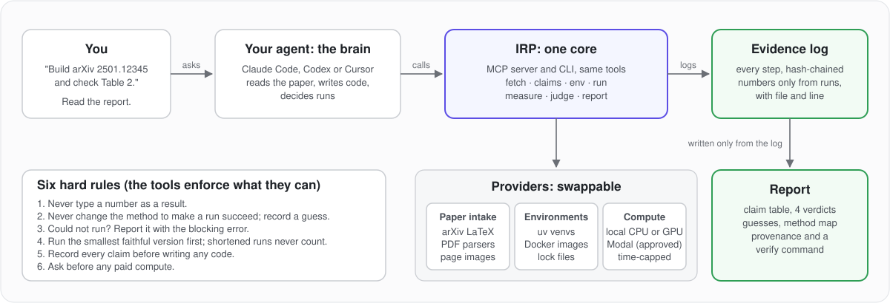

<div align="center">

[English](../../README.md) · [简体中文](README_zh.md) · [日本語](README_ja.md) · **한국어** · [Español](README_es.md) · [Italiano](README_it.md)

# IRP: 어떤 논문이든 구현하고, 모든 주장을 증명하세요.

### 코딩 에이전트가 연구 논문을 동작하는 코드로 바꾸고, 실행하고, 주장마다 얼마나 가깝게 재현했는지 증명하게 해 주는 MCP 서버이자 CLI.

**논문을 주면, 동작하는 코드와 에이전트를 믿지 않고도 검증할 수 있는 보고서를 받습니다.**

[](https://pypi.org/project/irp-agents/)
[](../mcp-contracts.md#generated-catalog)
[](#재현할-수-있는-것)
[](../../LICENSE)

[빠른 시작](#빠른-시작) · [동작 방식](#동작-방식) · [보고서](#보고서) · [재현할 수 있는 것](#재현할-수-있는-것) · [FAQ](#faq) · [문서](#문서)

<code>uvx irp-agents setup</code>

</div>

> [!IMPORTANT]
> IRP은 [Noshadi-sec/irp](https://github.com/Noshadi-sec/irp) 또는
> [PyPI의 irp 패키지](https://pypi.org/project/irp-agents/)에서만 받으세요.
> 비슷한 저장소 이름이나 복사된 README는 공식 배포처임을 보장하지 않습니다.

<div align="center">



</div>

---

코드가 없는 논문, 혹은 믿기 어려운 코드가 있는 논문을 발견했나요? 에이전트에게 IRP으로
구현하라고 하세요. 에이전트는 논문을 읽고, 논문이 주장하는 모든 숫자를 기록하고, 구현을 작성하고,
실행해서 결과를 비교합니다. IRP은 가져오기, 실행, 기록을 맡고 지름길을 거부합니다.
손으로 입력한 숫자는 절대 인정되지 않고, 단축 실행도 절대 인정되지 않으며, 보고서는 증거
로그만으로 작성됩니다.

IRP은 에이전트(Claude Code, Codex, Cursor)를 논문 읽기, 환경, 실행, 측정, 판정 도구에
연결합니다. 같은 도구를 터미널에서도 쓸 수 있습니다. 모든 것은 로컬에서 실행되며, IRP은
모델을 직접 호출하지 않습니다.

## 빠른 시작

### 에이전트 설정

[uv](https://docs.astral.sh/uv/)를 설치한 뒤 실행하세요:

```bash
uvx irp-agents setup
```

설정할 에이전트를 고르고, 제안된 변경 사항을 검토한 뒤 승인하세요. setup은 IRP의 MCP 서버와
워크플로 스킬을 추가하고 기존 설정을 백업합니다. 끝나면 에이전트를 다시 시작하세요.

setup은 Claude Code, Codex, Cursor를 지원합니다. 다른 MCP 클라이언트는
[수동 등록](../installation.md#manual-registration)을 사용하세요.

### 에이전트에게 요청하기

```text
Build arXiv 2501.12345 and check Table 2.
```

동작하는 코드 폴더와 보고서(각 주장, 논문의 숫자, 당신의 숫자, 판정)를 받습니다.

### 터미널 사용

모든 도구는 명령으로도 쓸 수 있습니다. 논문을 새 스터디로 가져와 개요를 읽습니다:

```bash
irp fetch 2501.12345 --study ~/studies/example
irp section index --study ~/studies/example
```

자주 쓴다면 `irp` 명령을 설치하세요:

```bash
uv tool install irp-agents
irp --help
```

터미널 전체 워크플로는 [CLI 가이드](../cli.md)를 보세요.

### 준비 상태 확인

```bash
irp doctor
```

doctor는 Python, uv, git, Docker, GPU, 디스크 공간, 에이전트 등록을 확인하며 아무것도 바꾸지 않습니다.

### IRP 업데이트

```bash
irp update
```

uvx를 쓴다면 `uvx irp-agents@latest setup`으로 에이전트 설정을 새로 고치고, 계획을 검토한 뒤
에이전트를 다시 시작하세요.

## 동작 방식

에이전트가 생각하고, IRP이 실행하며 기록을 남깁니다. 에이전트는 논문을 읽고 코드를 쓰고
무엇을 실행할지 정합니다. 모든 동작은 하나의 코어를 거치므로 CLI와 MCP 서버가 똑같이 동작하고,
모든 단계가 추가 전용의 해시 체인 증거 로그에 남습니다. 보고서는 이 로그만으로 만들어집니다.

| 단계 | 도구 | 하는 일 |
| --- | --- | --- |
| 읽기 | `fetch_paper` | arXiv LaTeX 소스나 PDF를 내려받아 해시를 계산하고 섹션으로 나눔 |
| 읽기 | `get_section`, `get_page_image` | 파일과 줄 번호가 붙은 섹션 본문, 또는 수식과 그림을 위한 페이지 이미지를 반환 |
| 주장 | `add_claim`, `list_claims` | 지표, 값, 위치, 성공 기준과 함께 각 주장을 기록 |
| 계획 | `add_guess` | 논문이 빠뜨린 세부 사항, 선택한 값, 이유를 기록 |
| 계획 | `map_method` | 수식이나 알고리즘 단계를 파일과 줄에 연결 |
| 빌드 | `create_env` | uv 환경 또는 Docker 이미지를 만들고 잠금 파일을 작성 |
| 실행 | `run`, `run_status` | 명령 하나를 실행하고 출력, 종료 코드, 시간, 메모리, 시드, 커밋, 파일을 저장 |
| 실행 | `run_remote` | 비용 추정과 승인 후 유료 GPU에서 같은 일을 수행 |
| 측정 | `extract_metrics` | 로그와 결과 파일에서 파일과 줄 번호와 함께 숫자를 추출 |
| 판정 | `compare`, `add_note` | 주장과 측정을 나란히 놓고 네 가지 판정 중 하나를 내림 |
| 보고서 | `report`, `verify`, `study_status` | 로그로부터 report.md와 report.json을 작성하고 해시 체인을 재검증 |

워크플로 스킬은 에이전트에게 여섯 가지 엄격한 규칙을 주고, 도구는 가능한 곳에서 이를 강제합니다:

1. 숫자를 결과로 입력, 추정, 복사하지 않는다.
2. 실행을 성공시키려고 논문의 방법을 바꾸지 않는다. 대신 추측으로 기록한다.
3. 억지로 진행하지 말고, 막힌 오류와 함께 "실행할 수 없음"을 보고한다.
4. 가장 작은 충실한 버전을 먼저 실행한다. 단축 실행은 절대 인정되지 않는다.
5. 코드를 쓰기 전에 모든 주장을 기록한다.
6. 유료 연산 전에는 반드시 묻는다.

## 보고서

보고서가 곧 제품입니다. 사람이 에이전트를 믿지 않고도 모든 판정을 검증할 수 있어야 합니다.
보고서는 다섯 부분으로 이뤄집니다: 주장 표, 네 가지 판정(재현됨, 근접, 이번 실행에서 재현되지 않음,
실행할 수 없음), 추측 목록, 수식에서 코드 줄로 이어지는 방법 지도, 그리고 출처 정보(arXiv ID와
버전, 파일 해시, git 커밋, 잠금 파일, GPU, 시드, 종료 코드가 있는 모든 명령, 해시 체인을
재검증하는 verify 명령).

모든 주장에 증거가 있는 판정이 나오기 전에는 에이전트가 작업을 끝낼 수 없습니다.

`report.md` 예시(가상의 숫자):

```markdown
# Reproduction report: Example Paper (arXiv 2501.12345v2)

Result: 2 reproduced, 1 close, 1 could not run (of 4 claims)

| Claim | Where | Paper | Ours | Verdict |
| --- | --- | --- | --- | --- |
| c1 Test accuracy | Table 2, row 3 | 94.1% | 93.8% (3 seeds, std 0.2) | close |
| c2 Training loss | Figure 4 | 0.31 | 0.31 (3 seeds) | reproduced |
| c3 Speed-up | Section 5.2 | 2.0x | 2.1x | reproduced |
| c4 ImageNet top-1 | Table 3 | 81.2% | not run: needs 8 GPUs for 2 days | could not run |
```

각 필드는 [증거와 보고서](../evidence-and-report.md)를 보세요.

## 재현할 수 있는 것

IRP은 macOS 또는 Linux에서 Python 3.11+가 필요합니다. 그 밖의 도구는 논문에 따라 다릅니다:

| 필요 | IRP이 쓰는 것 | 요구 사항과 가이드 |
| --- | --- | --- |
| 논문 읽기 | arXiv LaTeX 소스를 우선, 다음으로 PDF, 수식과 그림을 위한 페이지 이미지 | arXiv 접근; [논문 읽기](../paper-intake.md) |
| 더 나은 PDF 구조 | 텍스트와 표에 Docling | 선택 사항 `irp-agents[docling]` |
| 환경 | 잠금 파일이 있는 uv 가상 환경, 또는 격리를 위한 Docker 이미지 | uv 또는 Docker; [환경](../environments.md) |
| 연산 | 내 CPU나 GPU; 비용 추정과 승인 후 Modal GPU 샌드박스(실험적) | 선택 사항 `irp-agents[modal]`; [연산](../compute.md) |
| 에이전트 | Claude Code, Codex, Cursor; 다른 MCP 클라이언트는 수동 등록 | [설치](../installation.md) |

IRP은 계산 논문(머신러닝, 알고리즘, 시뮬레이션)을 지원합니다. 웻랩 실험이나 무기와 관련된
작업은 지원하지 않습니다.

## 쇼케이스

아직 공개된 쇼케이스는 없습니다. 각 쇼케이스는 자체 저장소와 보고서를 갖습니다. 진행 상황은
[로드맵](../roadmap.md)을 보세요.

## FAQ

<details>
<summary><strong>어떤 에이전트에서 쓸 수 있나요?</strong></summary>

로컬 MCP 서버를 지원하는 모든 에이전트에서 쓸 수 있습니다. setup은 Claude Code, Codex, Cursor를 설정합니다.

</details>

<details>
<summary><strong>IRP이 AI 모델을 호출하거나 논문을 업로드하나요?</strong></summary>

아니요. 두뇌는 당신의 에이전트이고, IRP은 모델을 호출하지 않으며 API 키도 없습니다.
arXiv에서 논문을 내려받고, uv나 Docker로 패키지를 설치하고, 당신의 컴퓨터에서 코드를 실행합니다.

</details>

<details>
<summary><strong>논문의 코드를 실행해도 안전한가요?</strong></summary>

uv 가상 환경은 샌드박스가 아니며, 코드는 당신의 권한으로 실행됩니다. 직접 쓰지 않았거나 믿을 수
없는 코드에는 `backend: "docker"`를 쓰세요. [보안 정책](../../SECURITY.md)도 참고하세요.

</details>

<details>
<summary><strong>"재현되지 않음"은 무슨 뜻인가요?</strong></summary>

이번 실행(기록된 추측 포함)이 정한 기준 안에서 논문의 숫자에 이르지 못했다는 뜻입니다. 보고서에는
"not reproduced by this run"이라고 쓰이고 모든 추측이 나열됩니다. 한 번의 시도에 대한 증거일 뿐
논문에 대한 판결이 아닙니다. 공개하기 전에 저자에게 연락하세요.

</details>

<details>
<summary><strong>IRP이 돈을 쓰나요?</strong></summary>

터미널에서 `irp budget`으로 가격과 예산을 기록하고, 에이전트가 보여 준 추정치를 당신이 승인한
경우에만 유료 GPU를 씁니다. 실행 시간 상한은 추정한 시간과 같습니다.

</details>

## 문서

- [설치와 설정](../installation.md)
- [CLI](../cli.md)
- [MCP 계약](../mcp-contracts.md)과 [프롬프트](../mcp-prompts.md)
- [증거와 보고서](../evidence-and-report.md)
- [논문 읽기](../paper-intake.md), [환경](../environments.md), [연산](../compute.md)
- [벤치마크](../benchmarks.md)와 [로드맵](../roadmap.md)

취약점은 [SECURITY.md](../../SECURITY.md)를 통해 보고하세요.

## 면책 조항

책임 있는 사용에 대해서는 [DISCLAIMER.md](../../DISCLAIMER.md)를 보세요. "재현되지 않음" 판정은 한 번의
실행에 대한 증거이며, 논문이나 저자에 대한 평가가 아닙니다.

## 기여

기여를 환영합니다. 개발 설정은 [CONTRIBUTING.md](../../CONTRIBUTING.md)를 보세요.

## 라이선스

[MIT](../../LICENSE). 제3자 자료는 각자의 라이선스를 따릅니다. [제3자 고지](../../THIRD_PARTY_NOTICES.md)를 보세요.
